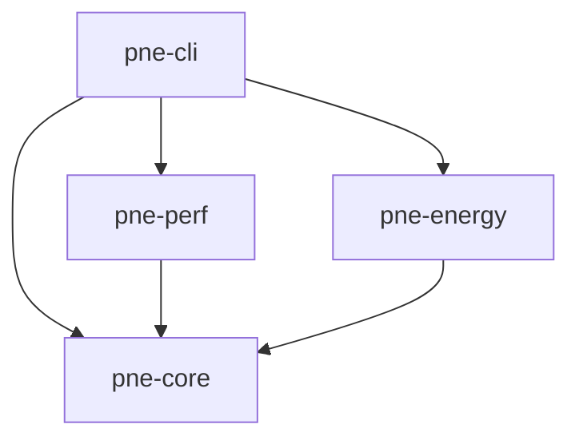
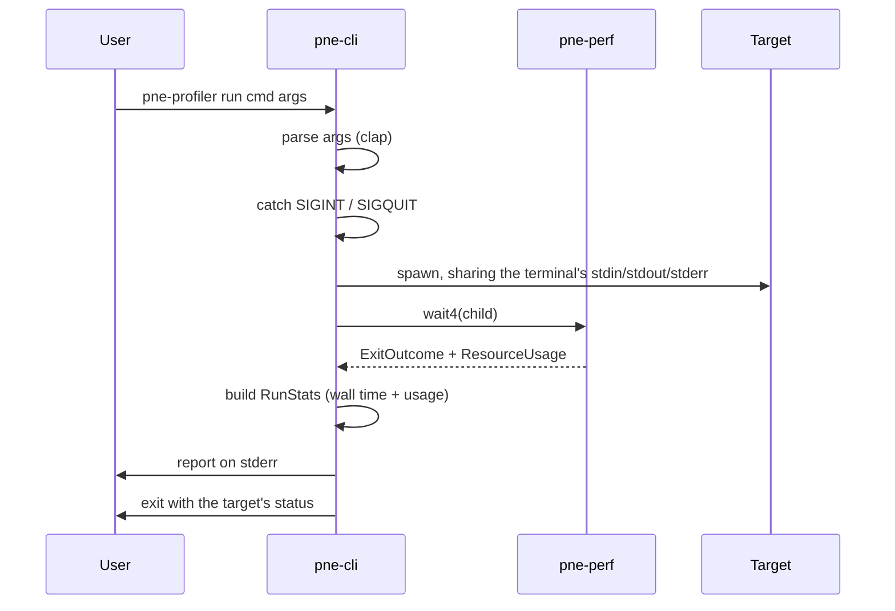

# Architecture

How `pne-profiler` is put together today, and the rules that keep it that way.
Anything not built yet is marked **planned**.

## Crate structure

The project is a Cargo workspace with one crate per concern under `crates/`.

| Crate        | Owns                                                                                       |
|--------------|--------------------------------------------------------------------------------------------|
| `pne-cli`    | The `pne-profiler` binary: argument parsing, spawning the target, signal handling, exit codes, printing the report. |
| `pne-core`   | OS-independent types shared by everything: `Bytes`, `ExitOutcome`, `ResourceUsage`, `RunStats`, and the report's formatting. |
| `pne-perf`   | Raw Linux syscalls and the `unsafe` code behind them. Today that's `wait4`, which reaps the target and returns its CPU time and peak memory. `perf_event_open` counters are **planned**. |
| `pne-energy` | Energy readings through RAPL powercap sysfs, then GPU power APIs. **Planned**: the crate is an empty stub. |

**Dependency rule:** arrows point down only. `pne-core` depends on no
internal crate, and collector crates (`pne-perf`, `pne-energy`) never depend on
each other or on `pne-cli`. A new subsystem, such as eBPF or distributed
aggregation, becomes a new crate under `crates/` instead of growing an
existing one.

## Runtime flow

`pne-profiler run <cmd> [args...]` is the only command so far.

1. **Parse.** clap reads the command line. Everything after `run` belongs to
   the target, including flags like `--help`.
2. **Spawn and wait.** The profiler starts a wall clock, spawns the target,
   and waits for it with `pne_perf::wait4` instead of `Child::wait`, because
   `wait4` also returns the target's resource usage. Ctrl-C and Ctrl-\ are
   caught, not ignored, so the profiler survives them while the target keeps
   their default handling.
3. **Collect.** Today the only data is what the kernel hands back when it
   reaps the target: user and system CPU time and peak RSS. Live sampling
   (counters, energy) is **planned**.
4. **Aggregate.** `pne-cli` combines the wall time and the `ResourceUsage` into
   a `RunStats`. Derived metrics, such as CPU utilization, are methods on
   `RunStats`, so they're computed from the data rather than stored.
5. **Report.** `RunStats` implements `Display`, and `pne-cli` prints it to
   stderr. The profiler then exits with the target's code, `128 + signal` if
   the target was killed by a signal, or the shell's 127 or 126 if it couldn't
   be started.

## Design principles

- **stdout belongs to the target.** The target inherits the terminal's stdio,
  and the profiler writes only to stderr, so `pne-profiler run cmd | next`
  pipes exactly what `cmd` would have.
- **`unsafe` only in `pne-perf`.** Every other crate declares
  `#![forbid(unsafe_code)]`. Each `unsafe` block in `pne-perf` carries a
  `// SAFETY:` comment, which clippy's `undocumented_unsafe_blocks` lint
  checks, and `pne-perf` exposes only safe functions.
- **Measurement is separate from presentation.** Collectors return plain data
  types from `pne-core` and never format anything. The report only formats
  data it is given and never measures. A different output format, such as
  JSON or a TUI, should only need a new renderer.
- **Degrade gracefully.** A missing permission or feature costs one metric, not
  the run. Today, failing to install the Ctrl-C handlers prints a warning and
  carries on. The same rule will apply to RAPL counters that need root and to
  `perf_event_paranoid` limits (**planned**).
- **Linux first.** The profiler relies on Linux syscalls, `/proc`, and sysfs
  directly instead of hiding them behind a portability layer. Supporting
  another OS isn't a goal yet.

## Where we're heading (planned, not built)

- **Collector trait.** Each data source (perf counters, RAPL, GPU power, later
  eBPF) implements one shared trait: set up before the target runs,
  read after it ends, and contribute its metrics to `RunStats`. `pne-cli`
  would then run a list of collectors instead of calling each one by hand.
  Counters that must be attached before the target's first instruction will
  need the target paused between `fork` and `exec`.
- **Multi-node agents.** For MPI jobs, an agent on each node runs the local
  collectors and streams samples to an aggregator, which merges them into one
  report per job, including energy per result across all nodes.
